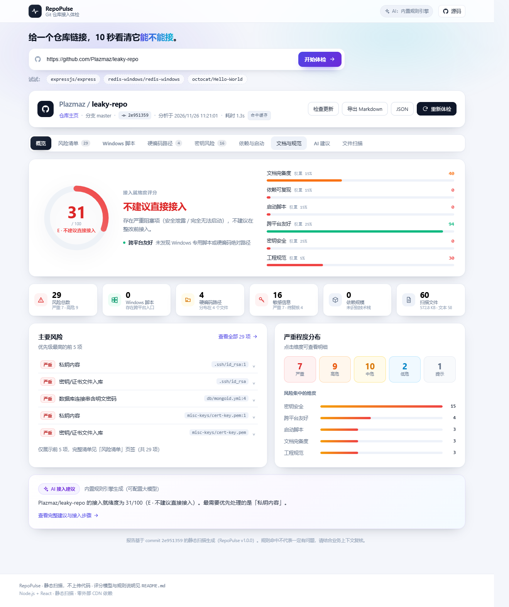
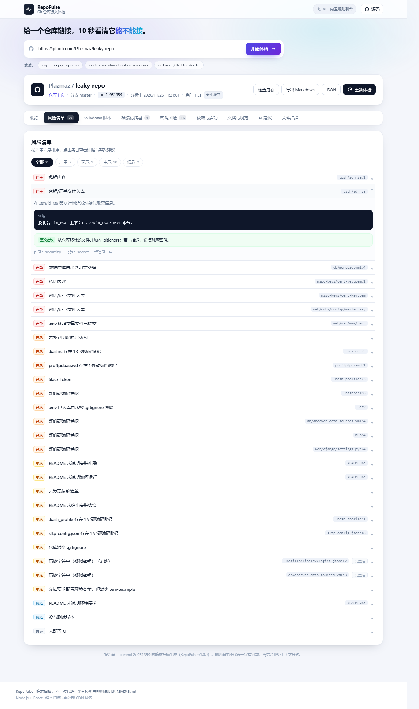
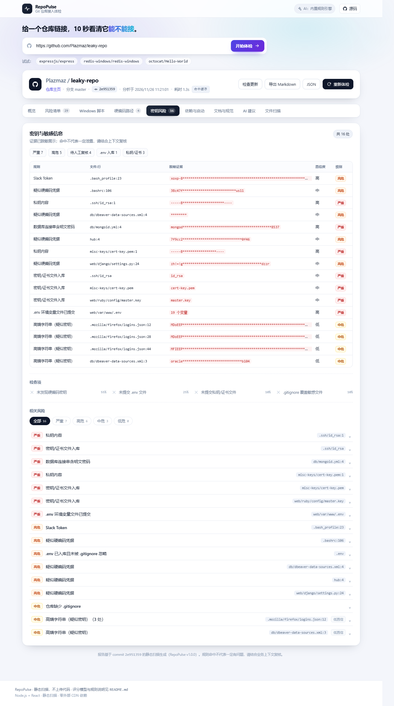
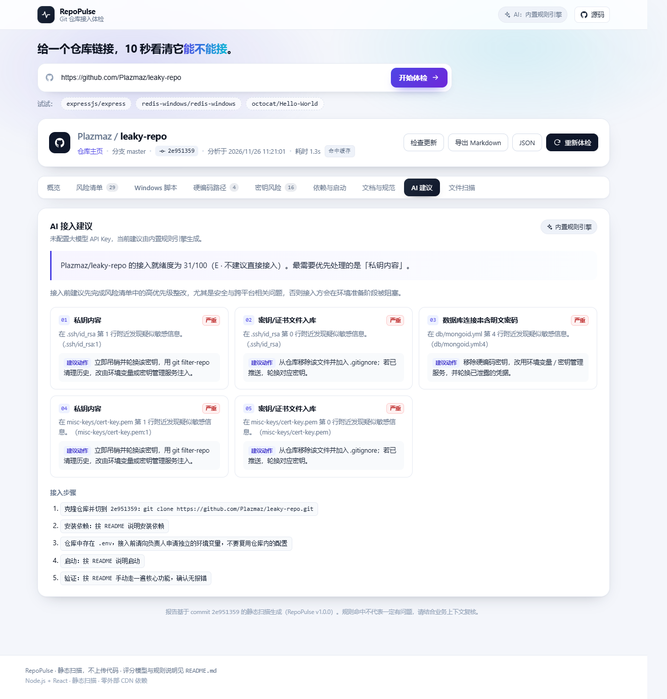

# RepoPulse · Git 仓库接入体检

[](https://github.com/kiwifruit3/git-onboarding-check/actions/workflows/ci.yml)

> 给一个公开仓库链接，10 秒看清它**能不能接**：README / 依赖 / 启动脚本是否齐全、有没有 Windows 专用脚本、有没有硬编码绝对路径、有没有密钥泄露，最后给出一份**接入就绪度评分**和**可执行的整改清单**。


## 目录

- [它能做什么](#它能做什么)
- [快速开始](#快速开始)
- [使用方式](#使用方式)
- [评分模型](#评分模型)
- [检测规则与误报控制](#检测规则与误报控制)
- [更新跟踪设计](#更新跟踪设计)
- [架构与目录](#架构与目录)
- [配置项](#配置项)
- [已知限制](#已知限制)
- [实测效果](#实测效果)
- [AI 使用说明](AI_USAGE.md)

## 它能做什么

| 维度 | 检查内容 | 输出 |
| --- | --- | --- |
| 📄 文档完备度 | README 是否存在、安装/运行/环境/配置/截图/许可证等章节覆盖、命令示例、占位符 | 章节覆盖表 + 检查项 |
| 📦 依赖可复现 | package.json / requirements.txt / go.mod / Cargo.toml / pom.xml 等 9 类生态，锁文件、版本固定、开发依赖拆分 | 生态表 + 缺失项 |
| ▶️ 启动脚本 | package.json scripts、Makefile 目标、Dockerfile / compose、Procfile、Windows 脚本入口 | 可执行入口表 |
| 🪟 Windows 专用脚本 | `.bat` / `.cmd` / `.ps1` / `.vbs` 清单，是否被 README 引用、是否有跨平台等价脚本 | 脚本表 + 风险 |
| 🧭 硬编码路径 | `C:\`、`D:/`、`/Users/`、`/home/`、UNC `\\server\share`、`/opt`、`file:///` | 文件:行号 + 命中内容 |
| 🔑 密钥与敏感信息 | `sk-`、`AKID`、`AKIA`、`Bearer`、JWT、私钥、数据库连接串、`.env` 入库、高熵字符串 | 脱敏证据 + 置信度 |
| 🧮 综合评分 | 6 个维度加权，0–100 分 + A–E 等级 + 结论 | 仪表盘 + 维度条 |
| 🤖 AI 建议 | 内置规则引擎生成接入建议与步骤；配置大模型 Key 后可切换为 LLM 生成 | 结论 + 建议卡 + 步骤 |

界面截图：

| 体检报告总览 | 风险清单（可展开证据） |
| --- | --- |
|  |  |

| 密钥与敏感信息 | AI 接入建议 |
| --- | --- |
|  |  |

## 快速开始

### 环境要求

- **Node.js ≥ 18.17**（使用原生 `fetch`、`Readable.fromWeb`）
- **git**（用于 `git ls-remote` 解析仓库 HEAD）
- 可访问 github.com / codeload.github.com 的网络（企业网络下工具会自动探测可用代理）

```bash
git clone https://github.com/kiwifruit3/git-onboarding-check.git
cd git-onboarding-check
npm install

# 生产模式：一个端口同时提供页面和接口
npm run build
npm start            # 打开 http://127.0.0.1:8787

# 开发模式：Vite 热更新（前端 5273，接口 8787）
npm run dev          # 打开 http://127.0.0.1:5273
```

也可以直接用命令行体检，便于接入 CI：

```bash
node scripts/smoke.mjs https://github.com/expressjs/express
node scripts/smoke.mjs https://github.com/owner/repo --json > report.json
node scripts/smoke.mjs https://github.com/owner/repo --refresh   # 忽略缓存重新分析
```

### 测试

```bash
npm test            # 规则单测：临时构造一个「问题仓库」，断言六类规则命中且证据已脱敏
npm run typecheck   # TypeScript 类型检查
npm run build       # 前端构建
```

`npm test` 不依赖网络，已在 GitHub Actions（Node 18/20/22）中执行。

> Windows 上如果 `npm` 被执行策略拦截，用 `npm.cmd install`，或直接 `node node_modules/vite/bin/vite.js`。
> 本机 git 配置了失效代理时，工具会自动探测并回退（见[配置项](#配置项)）。

## 使用方式

### Web 页面

1. 粘贴公开仓库地址（支持 `https://github.com/owner/repo`、`git@github.com:owner/repo.git`、`owner/repo` 简写，以及 GitLab / Gitee）。
2. 等待 3–20 秒（首次需要拉取源码快照，同一 commit 第二次直接命中缓存）。
3. 查看评分、维度条、风险清单；页签可下钻到 Windows 脚本、硬编码路径、密钥、依赖、文档、AI 建议、文件扫描。
4. 支持「导出 Markdown / JSON」，报告头部会标注所基于的 commit。

### 网络受限 / 没有梯子怎么办

工具本身**不依赖任何 CDN 或外部资源**，页面永远能打开；只有「拉取目标仓库」这一步需要访问 GitHub。国内直连 GitHub 时常通时不通，可以按需选择：

| 场景 | 做法 |
| --- | --- |
| 有系统代理（Clash / v2ray 等） | 什么都不用配，工具会自动探测并使用系统代理 |
| 需要显式指定代理 | `REPOPULSE_PROXY=http://127.0.0.1:7890` |
| 想走镜像加速 | `REPOPULSE_MIRROR=https://ghproxy.net/`（同时作用于源码包下载与 clone） |
| 只是想看效果、完全断网 | 首页「离线示例（无需网络）」三个按钮，直接打开预生成的完整报告 |
| 内网/演示环境 | `REPOPULSE_FORCE_OFFLINE=1`，只返回历史缓存报告并标注「可能不是最新」 |

失败时不会白屏：页面会给出明确原因（DNS 失败 / 连接超时 / 仓库不存在）和可操作建议，并保留「重试」和「看示例报告」入口。

### HTTP API

```bash
# 体检
curl -X POST http://127.0.0.1:8787/api/analyze \
  -H 'Content-Type: application/json' \
  -d '{"url":"https://github.com/expressjs/express","refresh":false}'

# 检查远端是否有新提交（更新跟踪）
curl -X POST http://127.0.0.1:8787/api/check-update \
  -H 'Content-Type: application/json' \
  -d '{"url":"https://github.com/expressjs/express","commit":"<上次报告里的 commit>"}'

# 健康检查
curl http://127.0.0.1:8787/api/health
```

## 评分模型

总分 = Σ（维度得分 × 权重），权重合计 100，按「接入方视角的阻塞程度」设计：

| 维度 | 权重 | 说明 |
| --- | ---: | --- |
| 密钥安全 | 25% | 硬编码密钥、私钥、`.env` 入库、`.gitignore` 覆盖 |
| 跨平台友好 | 25% | Windows 专用脚本（45%）+ 硬编码路径（55%） |
| 文档完备度 | 15% | README 章节覆盖与可操作性 |
| 依赖可复现 | 15% | 清单 + 锁文件 + 版本约束 |
| 启动脚本 | 15% | 明确的安装 / 启动 / 构建 / 测试入口 |
| 工程规范 | 5% | `.gitignore` / LICENSE / CI / `.env.example` |

等级：**A ≥ 85**（可直接接入）、**B 70–84**（小改后可接入）、**C 55–69**（需要整改）、**D 40–54**（风险较高）、**E < 40**（不建议直接接入）。

几条特意做的「人性化」判定：

- **库项目不按应用扣分**：`package.json` 有 `main/exports/files` 且无 `start/dev` 脚本时判定为库，缺失锁文件降为低危，没有 `start` 不算「缺少启动入口」。
- **测试 fixture 不计入评分**：测试目录 / `_test.go` / `testdata/` 里的「密钥」只作为**待人工复核**线索，置信度标低，不参与评分。
- **规则定义文件识别**：仓库里如果出现 `regexp.MustCompile` / `SecretGroup` 这类密钥扫描规则定义，其中的示例字符串不会当成真实泄露。
- **证据脱敏**：所有命中的密钥都按「前 6 位 + `*` + 后 4 位」展示，避免报告本身成为泄露源。

## 检测规则与误报控制

### 1. README 完整度

识别根目录 `README.md/.rst/.txt`（含 `docs/README.md` 兜底），按 11 个检查项打分：存在性、正文长度（600/1500 字两档）、安装步骤、使用说明、环境要求、配置项、代码示例（≥2 段）、截图、许可证、贡献指南。中英文标题关键词同时匹配（如「安装 / Install / 快速开始」）。

### 2. 依赖清单

覆盖 Node.js、Python、Go、Rust、Java、PHP、Ruby、.NET、Dart 共 9 类生态：识别清单文件与锁文件、统计运行时/开发依赖、检测 `*` / `latest` / `>=0.0.0` 这类未锁定版本。

### 3. Windows 专用脚本

扫描 `.bat` / `.cmd` / `.ps1` / `.psm1` / `.vbs`，输出首行内容、是否被 README 引用、同目录下是否有同名 `.sh`/Node 等价脚本。**README 直接要求执行 `.bat` 时记高危**——这是最典型的「Mac 同事拿到就跑不起来」。

### 4. 硬编码路径

6 类规则：Windows 盘符、UNC 共享、`/Users/`、`/home/`、系统级路径（`/opt`、`/usr/local`、`/var/www`…）、`file://`。

误报控制：

- 用负向后行断言排除 `https://` 里的 `s:/`；
- 过滤 JS 转义序列（`\\u003c`、`\\n`）被误判成 UNC 路径；
- 测试目录 / `_test.*` / `*.spec.*` 命中降为低危，不影响评分；
- 文档里的路径降为低危（README 里写 `C:\` 通常是示例，但会提示）。

### 5. 密钥与敏感信息

规则：私钥块、OpenAI/Anthropic Key、AWS `AKIA/ASIA`、腾讯云 `AKID`、GitHub/GitLab Token、Slack、Google API Key、Stripe、JWT、Bearer、数据库连接串、通用 `api_key/password` 赋值、高熵字符串，以及 `.env` / `.pem` / `id_rsa` 等文件入库。

误报控制（实测下来这一步最重要）：

| 策略 | 说明 |
| --- | --- |
| 占位符过滤 | `your-key`、`xxx`、`abc123`、`<token>`、`process.env`、`${...}` 直接跳过 |
| 显式豁免 | 尊重 `gitleaks:allow`、`nosec`、`pragma: allowlist secret` 等注释 |
| 私钥主体校验 | 只有 `-----BEGIN ... PRIVATE KEY-----` 且后续 10 行内有 40+ 字符 base64 主体才算，避免把规则里的文件头当成泄露 |
| fixture 降级 | 测试目录 / `_test.go` / `testdata/` 命中 → 低危 + 低置信，**不计入评分** |
| 密度检测 | 同一文件同一规则命中 ≥5 次 → 判为样例数据（典型是密钥扫描器自己的规则库） |
| 脱敏输出 | 证据只展示前后各几位，中间打码 |

### 6. 工程规范

`.gitignore`、LICENSE、CI 配置、`.env.example`（README 提到环境变量但缺少样例时提示）。

### 7. `.repopulseignore`（跳过不想被扫的文件）

在仓库根目录放一个 `.repopulseignore`，命中的文件不参与规则扫描，报告会注明忽略了多少个：

```gitignore
# 忽略目录
demo/
vendor/
# 忽略任意层级的匹配文件
*.min.js
# 路径通配
docs/generated/**
```

用途：忽略 vendored 代码、生成产物、测试 fixture——它们命中规则通常不代表真实问题。
本仓库自身就用它跳过了 `demo/`（离线示例报告里含示例密钥与路径）。

## 更新跟踪设计

> 题目第 5 条要求。当前已实现 **commit 级缓存 + 手动/接口触发的更新检测**；文件级增量扫描作为设计给出（未实现的部分会明确标注）。

### 1. 怎么发现更新

**不使用 GitHub REST API**：匿名调用 60 次/小时，实测几分钟就会 `403 API rate limit exceeded`（开发中真实踩到，见 AI_USAGE）。改用：

```bash
git ls-remote --symref <clone-url> HEAD
# 输出：ref: refs/heads/main  HEAD
#       <40 位 commit sha>      HEAD
```

一次请求同时拿到**默认分支**和**当前 HEAD commit**，不受 API 限流约束，且对 GitHub / GitLab / Gitee 通用。源码快照通过 `codeload.github.com/{owner}/{repo}/tar.gz/{sha}` 按 commit 精确下载（GitLab/Gitee 走各自 archive 地址），失败再回退 `git clone --depth 1`。

更新检测的三种触发方式：

| 方式 | 实现 |
| --- | --- |
| 手动 | 报告页「检查更新」按钮 → `POST /api/check-update`，返回远端最新 commit 与 `hasUpdate` |
| 重新体检 | `POST /api/analyze {"refresh": true}` 强制跳过报告缓存 |
| 定时巡检（设计） | 对关注的仓库列表按 cron 每天跑一次 `check-update`，SHA 变化才触发重新分析并推送 diff 摘要 |

### 2. 怎么避免全量重算

当前实现（**已生效**）：

```
.cache/
├── src/{provider}-{owner}-{repo}-{sha12}/     # 按 commit 落地的源码快照，带 .ready 标记
│   └── ...
└── reports/{provider}-{owner}-{repo}-{sha}.json  # 完整报告，按 commit 缓存
```

- 同一个 commit 再次分析 → 直接返回缓存报告（页面显示「命中缓存」），耗时从 ~8s 降到 ~1.3s；
- 源码目录按仓库保留最近 4 份，自动清理旧快照，避免磁盘膨胀；
- 报告带 `schemaVersion`，规则升级后自动失效旧缓存，不会读到过期结论。

文件级增量（**设计**，当前未实现）：

```
fileHash = sha256(文件内容)
scanCache[fileHash] = { secrets: [...], paths: [...], windows: ... }   // 与 commit 无关
```

新 commit 分析时：`git diff --name-status old..new`（或比对两次文件哈希表）→ 只对**变更文件**重跑规则 → 未变更文件直接复用 `scanCache` → 重新聚合维度分与风险清单。文档/依赖/脚本这类**全局规则**（README、锁文件、入口）在相关文件变化时才重算，其余维度可沿用缓存结果。预期可以把「只改一个文件」的增量分析压到亚秒级。

### 3. 报告如何标注所基于的 commit

报告的 `meta` 中固定记录，并在 UI 与导出文件中展示：

```json
{
  "meta": {
    "repo": { "slug": "expressjs/express", "webUrl": "https://github.com/expressjs/express" },
    "branch": "master",
    "commit": "43fca52d28a422c8be48fd489cbd4f2d6152bab6",
    "commitShort": "43fca52d",
    "commitUrl": "https://github.com/expressjs/express/commit/43fca52d...",
    "analyzedAt": "2026-11-26T03:21:01.000Z",
    "source": { "strategy": "archive", "cached": false, "via": "system" },
    "scanner": { "name": "RepoPulse", "version": "1.0.0", "schemaVersion": 6 }
  }
}
```

- 页面头部显示 `commit 短 SHA` 并可点击跳转；
- 报告底部固定文案：「报告基于 commit `xxxx` 的静态扫描生成」；
- 导出的 Markdown / JSON 头部同样带 commit 与扫描器版本，便于对比两次报告的差异。

### 4. 失败与限流时怎么兜底

| 场景 | 兜底策略 |
| --- | --- |
| GitHub API 限流 | 架构上不依赖 REST API（`ls-remote` + archive 直下），天然规避；配置 `GITHUB_TOKEN` 时才会走 API 兜底 |
| 网络抖动 / 直连不稳 | `ls-remote` 3 次退避重试（0 / 1.2s / 3.5s），源码包每种通道再重试 1 次；仍失败则返回明确错误而不是卡死 |
| 国内直连不通 | 可选 `REPOPULSE_MIRROR=https://ghproxy.net/` 走镜像加速；或 `REPOPULSE_PROXY` 指定代理；工具本身也会自动探测系统代理 |
| 源码包下载失败 | 回退 `git clone --depth 1 --single-branch`；再失败才报错 |
| 本机代理失效 | 按「环境变量 → git config → Windows 系统代理（WinINET）→ 直连」探测可用代理，TCP 探测失败直接跳过；git 失败后换模式重试一次 |
| 大仓库 | 源码包上限 200MB、文件数上限 12000、单文件文本 512KB、文本总量 48MB，超限降级并在报告中标注 `truncated` |
| 网络完全不通 | ① 若该仓库分析过 → 自动返回**历史缓存报告**并打上「可能不是最新」横幅；② 首页提供**离线示例报告**（`demo/reports/*.json`，预生成快照），零网络也能体验全部功能；③ `REPOPULSE_FORCE_OFFLINE=1` 可显式进入离线模式 |
| 并发 | 服务端并发上限 2，超出的请求排队；单请求超时 300s |

## 架构与目录

```
git-onboarding-check/
├── server/                    # Node 原生 http 服务 + 分析引擎（零框架依赖）
│   ├── index.mjs              # 路由、静态托管、并发控制、错误处理
│   └── lib/
│       ├── repo.mjs           # 仓库解析、ls-remote、源码包/克隆、代理探测、缓存
│       ├── walk.mjs           # 文件遍历、分类（code/doc/config/lock/binary）、二进制识别
│       ├── analyze.mjs        # 编排：规则 → 评分 → 风险聚合 → AI
│       ├── score.mjs          # 权重模型、等级、亮点
│       ├── ai.mjs             # 内置规则建议 + 可选 LLM（OpenAI/DeepSeek/通义兼容）
│       └── rules/             # 六类规则，独立可测
│           ├── readme.mjs  deps.mjs  scripts.mjs
│           ├── windows.mjs paths.mjs secrets.mjs  hygiene.mjs
├── web/                       # Vite + React + TypeScript（无 UI 框架/图表库）
│   └── src/{App.tsx, components/, styles.css, export.ts}
├── scripts/
│   ├── dev.mjs                # 同时拉起 API 与 Vite
│   ├── build-demo.mjs         # 生成离线示例报告（demo/reports/*.json）
│   └── smoke.mjs              # 命令行体检（也可做回归）
├── tests/rules.mjs            # 规则单测（离线，构造问题仓库断言命中）
├── demo/reports/              # 离线示例报告（断网也能看完整界面）
├── .github/workflows/ci.yml   # CI：npm test + 类型检查 + 构建
├── docs/screenshots/          # 界面截图
├── dist/                      # 构建产物（npm run build）
├── AI_USAGE.md
└── README.md
```

技术选择说明：

- **服务端零框架**：`node:http` 足够，减少依赖与启动成本；
- **前端零图表库**：评分环、维度条、进度条都是手写 SVG/CSS，包体 178KB（gzip 58KB）；
- **不依赖 GitHub API**：见上文「更新跟踪」；
- **AI 可选**：没有 Key 时用内置规则引擎生成建议（完全离线可用），配置 Key 后自动切换大模型。

## 配置项

| 环境变量 | 默认值 | 说明 |
| --- | --- | --- |
| `PORT` | `8787` | 服务端口 |
| `HOST` | `127.0.0.1` | 监听地址（容器部署可设 `0.0.0.0`） |
| `CHECK_CACHE_DIR` | `./.cache` | 缓存目录 |
| `REPOPULSE_PROXY` | – | 指定 git / 下载使用的代理，如 `http://127.0.0.1:7890` |
| `REPOPULSE_NO_PROXY` | – | 设为 `1` 强制直连 |
| `REPOPULSE_MIRROR` | – | 镜像/加速前缀，用于源码包下载与 clone。支持 `https://ghproxy.net/`（前缀拼接）或 `https://ghproxy.net/{url}`（模板） |
| `REPOPULSE_FORCE_OFFLINE` | – | 设为 `1` 强制离线：不访问网络，只返回历史缓存报告（用于断网演示 / 内网环境） |
| `GITHUB_TOKEN` | – | 仅在 `ls-remote` 失败时用于 API 兜底 |
| `OPENAI_API_KEY` / `OPENAI_BASE_URL` / `OPENAI_MODEL` | – | OpenAI 兼容通道，用于 AI 建议 |
| `DEEPSEEK_API_KEY` / `DEEPSEEK_MODEL` | – | DeepSeek 通道 |
| `DASHSCOPE_API_KEY` / `DASHSCOPE_MODEL` | – | 通义千问兼容模式 |

示例：`OPENAI_API_KEY=sk-xxx OPENAI_MODEL=gpt-4o-mini npm start`

## 已知限制

- 只支持**公开仓库**（私有仓库需要额外授权，未实现）。
- 静态扫描，不做依赖漏洞（CVE）分析、不执行代码、不判断业务逻辑正确性。
- 规则命中是「线索」而非结论，报告里都标注了置信度，需要人工复核。
- 文件级增量扫描目前是设计（见上文），当前按 commit 整体重算。
- 超大仓库（>200MB 源码包或 >12000 文件）会截断扫描，报告中标注 `truncated`。
- 评分权重是经验值，不同团队可以在 `server/lib/score.mjs` 中按需调整。

## 实测效果

| 仓库 | 得分 | 等级 | 主要发现 |
| --- | ---: | --- | --- |
| [kiwifruit3/git-onboarding-check](https://github.com/kiwifruit3/git-onboarding-check)（自检） | 97 | A | 仅剩文档与测试夹具中的示例路径命中，属于预期行为 |
| [expressjs/express](https://github.com/expressjs/express) | 86 | A | 库项目，未提交 lockfile（影响较小）；README 缺少运行说明 |
| [gitleaks/gitleaks](https://github.com/gitleaks/gitleaks) | 89 | A | 243 处「疑似密钥」全部识别为规则库样例数据，仅作待复核线索 |
| [redis-windows/redis-windows](https://github.com/redis-windows/redis-windows) | 65 | C | 只有 `start.bat` 启动入口，无跨平台等价脚本；34 处硬编码路径 |
| [Plazmaz/leaky-repo](https://github.com/Plazmaz/leaky-repo) | 31 | E | `.ssh/id_rsa`、`.pem` 私钥、`.env`、MongoDB 明文连接串入库 |

> 最后一列是工具自动产出的结论，可在本地复现：`node scripts/smoke.mjs <url>`。

## 开发过程与 AI 使用

本项目使用 **DeepSeek Harness（DSH）** 作为 AI Coding 工具完成，包含完整的提示词记录、验证方法与「AI 答错但被发现」的真实案例，见 [AI_USAGE.md](AI_USAGE.md)。

## License

[MIT](LICENSE)
